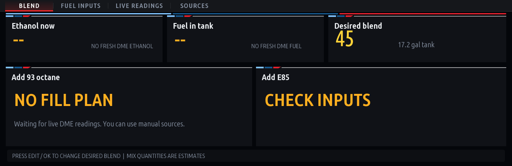

# TurnKey E Blend

**Open-source ethanol monitor and E85 blend-to-full calculator for modified BMW iDrive 7 / MGU head units.**



> **Beta — v0.1.6 source.** The inline editor was tested in a desktop preview, **not yet verified on the physical MGU**. On one 2023 BMW X3 M Competition, standalone ENET tests verified the ethanol RAM read and OBD fuel-level response. This does **not** establish universal BMW compatibility or validate the same requests through every MGU TASU gateway. The app is unofficial; it is not affiliated with BMW, MHD, or any fuel manufacturer.

## Features

- Read-only ethanol monitoring using a **calibration-specific** diagnostic memory address (should only be used after verifying compatibility).
- Fuel-level reading using standardized OBD Mode 01 PID `0x2F`; experimental KOMBI raw/60 alternative and manual override.
- Inputs for tank size, pump 93 ethanol %, pump E85 ethanol %, and desired E%.
- Blend-to-full result estimating how many US gallons of each fuel to add, or warning if target is mathematically impossible.
- Controller-operated editor and BMW M-inspired tri-color design.
- Sequential diagnostic polling with 1-second **target** interval; errors/backoff can make updates slower. Only polls while the app is displayed.

## Compatibility

**Known test setup:** 2023 X3 M Competition (F97 LCI), S58, iDrive 7 MGU, with a MHD flex-fuel calibration. DME logical address `0x12`; ethanol RAM `0xB00060D2`; response `63 2B` corresponded to E43 in a test, cross-checked with an MHD log. Fuel level `01 2F` returned `41 2F DD` (86.67%) over ENET. This address **must not be assumed to work on another DME or calibration**.

The default tank capacity in the app is **17.2 US gal**. Confirm the tank specification and actual fuel blend for your vehicle. Calculations assume an ideal, homogeneous mixture and do not account for fuel trapped in lines, sensor error, temperature effects, or dispenser variability. **Do not make fueling decisions based only on an unverified gauge or experimental KOMBI conversion.**

## Install through MGU Store (source build)

This repository provides an **MGU Store repo-tree source** through [`mgu-repo.json`](mgu-repo.json). MGU Store can build the app on a compatible head unit using a locally generated donor SDK; the GitHub repository contains no BMW SDK.

1. On your own **modified iDrive 7** head unit, have a working MGU Store installation and usable internet uplink (or follow the Store's offline USB source workflow).
2. In MGU Store, choose **Settings → Add source**. Enter `HasMan/turnkey-ethanol-blend`, and select **Branches → main** (not Releases) so the Store reads `mgu-repo.json`.
3. Look for **TurnKey E Blend** (`ethanol_mix`), confirm the displayed compatibility warnings, then install while parked and on stable power.
4. Check the app appears and opens. If your DME is unverified, use **manual inputs**, not the calibration-specific memory read as a source of truth.

**Beta:** On-head-unit Store installation of this version is not yet confirmed. The desktop build has been tested; actual compatibility depends on your MGU firmware, renderer, Store version and DME calibration. Existing manual installs of `ethanol_mix` may be treated as an update or may conflict; take a backup first. See [docs/mgu-store.md](docs/mgu-store.md).

## Build from source (Windows / macOS / Linux)

This project includes **a subset of the independently licensed** [cauliflowermossgrape/idrive7-apps](https://github.com/cauliflowermossgrape/idrive7-apps) build tools and runtime under its original MIT license. BMW's SDK is **not included**.

1. Install Python 3 and Node.js LTS.
2. Clone this repository, which includes the MIT-licensed build/runtime subset.
3. Follow the upstream [SDK extraction instructions](https://github.com/cauliflowermossgrape/idrive7-apps) to extract `oap-sdk/` from your own MGU; copy the generated `oap-sdk/` directory into the repository root. **Never commit or redistribute it.**
4. Run `python kit/tools/build.py ethanol_mix` to make a **local-only** `.mgu`; or run `python tools/build_store.py ethanol_mix` to create an SDK-free `.tgz` suitable for MGU Store.
5. Maintain a backup and verify compatibility before installing anything on your vehicle.

For exact Windows commands, see [docs/build-windows.md](docs/build-windows.md). For compatibility and safety notes, see [docs/compatibility.md](docs/compatibility.md).

### Run calculation tests without a BMW

```bash
node tests/blend.test.js
node tests/fuel_obd.test.js
```

## Source layout

```text
apps/ethanol_mix/app.json       App manifest, screens, settings and SOME/IP subscriptions
apps/ethanol_mix/main.js        UI, sequential DME reads, page navigation and input editing
apps/ethanol_mix/blend.js       Pure blend-to-full math
apps/ethanol_mix/fuel_obd.js    OBD PID 2F decoder
tests/                            No-car tests for blend math, fuel PID and repo metadata
assets/screenshots/              Desktop preview images
docs/                            Build, compatibility, distribution notes
```

## Distribution and licensing

The **original TurnKey code** is released under the MIT license. Selected `idrive7-apps` build/runtime files are redistributed under their original MIT license and attribution in [`LICENSE.idrive7-apps`](LICENSE.idrive7-apps). Font data also includes its accompanying license notice. BMW's `oap-sdk` is proprietary and must be extracted by each builder from their own unit. **Do not upload `.mgu` bundles generated with BMW's SDK to public GitHub Releases** or commit the SDK. The MGU Store source builder strips SDK content out of its `.tgz` output. Source releases are suitable for GitHub; independently distributing binaries would require separate rights clearance.

M-inspired graphic elements and product names do not imply any endorsement or official status.

## Credits

- [cauliflowermossgrape/idrive7-apps](https://github.com/cauliflowermossgrape/idrive7-apps) — independent MGU app toolkit (not bundled).
- MGU Store by [robertnisipeanu](https://github.com/robertnisipeanu/mgu-store) — owners add this repository as a source; it is **not** an official preconfigured Store source.

## Store source file layout

- `mgu-repo.json` — component metadata and on-unit Python build specification.
- `tools/build_store.py` — SDK-free `.tgz` builder using the head unit’s injected donor SDK.
- `kit/` — permitted MIT-licensed subset of the upstream kit (not BMW’s SDK).
- `LICENSE.idrive7-apps` and `THIRD_PARTY.md` — upstream attribution and notices.
